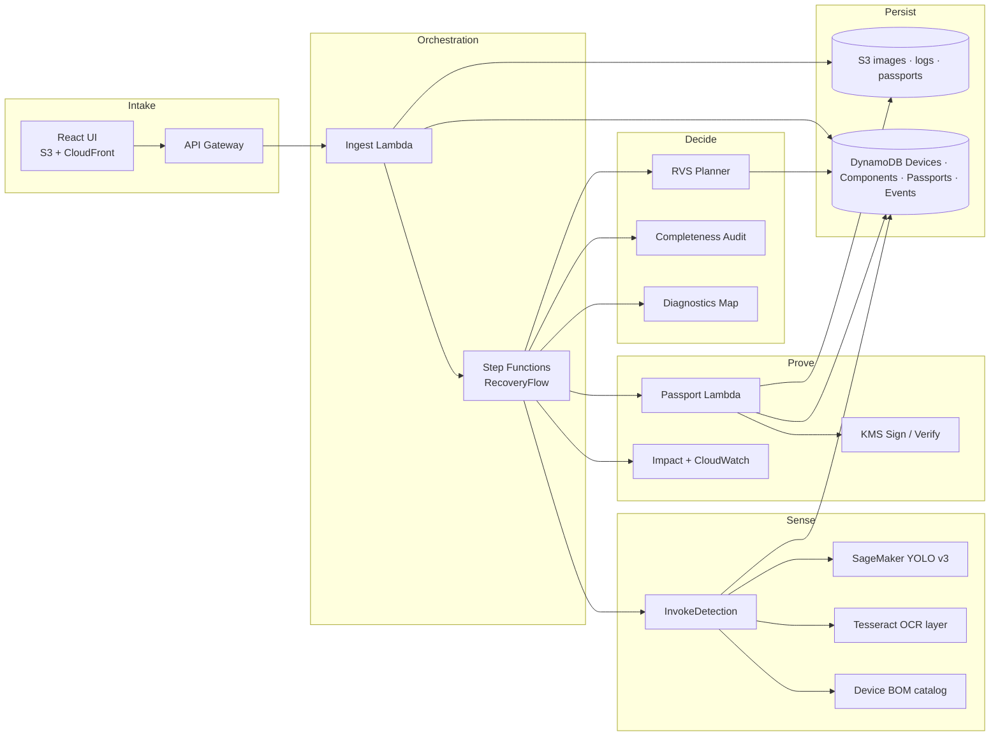
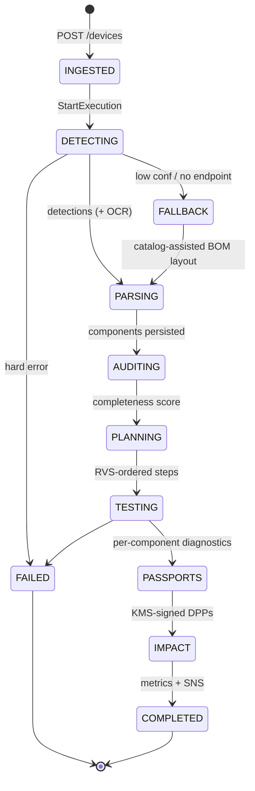
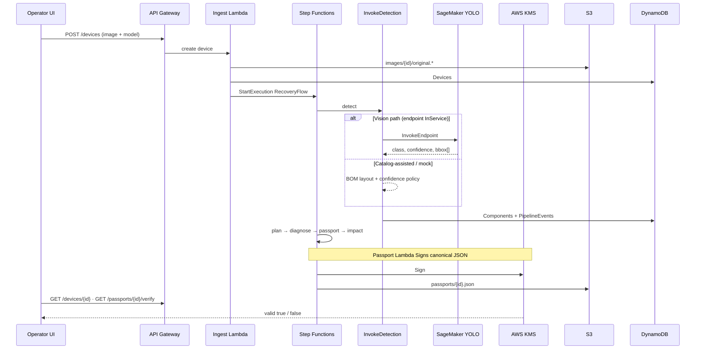

# RE:GENESIS

### Adaptive electronics recovery — see it, plan it, prove it, reuse it.

**Computer vision → BOM completeness → RVS-ranked disassembly → diagnostics → KMS-signed Second-Life Passports**

Built for [Environmental Hacks | Bharat Builds Tour](https://www.wemakedevs.org/aws/env) · Track: **Waste and Energy → E-waste**  
Repo: [github.com/mitra9917/ReGenesis](https://github.com/mitra9917/ReGenesis)

---

## Why this exists

Global e-waste reached **~62 million tonnes** in 2022. Most still-valuable GPUs, RAM, SSDs, and NICs are shredded for bulk metal recovery — destroying reuse value and locking embodied carbon into landfill economics.

**RE:GENESIS** treats a retired server or laptop as a *recoverable product*, not scrap:

| Industrial shredding | RE:GENESIS |
|----------------------|------------|
| Destroy first, sort metal later | Detect components *before* they are lost |
| No lineage for secondary buyers | **Second-Life Passport** (KMS-signed, verifiable) |
| Opaque ESG claims | Honest LCA ranges with cited factors |
| Manual guesswork on teardown order | **Reuse Value Score (RVS)** plans the sequence |

---

## What judges should see in 60 seconds

1. **Upload** an interior photo (or pick Dell PowerEdge R740 / ThinkPad T14 / Cisco Catalyst 9300).
2. **Vision** (SageMaker YOLOv8) or catalog-assisted fallback finds parts and scores **BOM completeness**.
3. **Step Functions** runs detect → parse → plan → diagnose → passport → impact — live on the device page.
4. **Verify** a passport: `valid: true` via AWS KMS. Tamper the JSON → verify fails.
5. **Impact** panel shows kg diverted + CO₂e avoided *ranges* (not fake precision).

> Deep docs: [Architecture](docs/ARCHITECTURE.md) · [AWS services](docs/AWS_SERVICES.md) · [Judging alignment](docs/JUDGING_ALIGNMENT.md) · [Demo script](docs/DEMO_SCRIPT.md)

---

## System at a glance



---

## End-to-end recovery workflow

One job = one device photo + catalog model key. Step Functions owns the pipeline so every stage is visible, retryable, and auditable.



### Stage map (what each stage *earns*)

| Stage | What happens | Why it matters |
|-------|----------------|----------------|
| **Ingest** | Image → S3; device row → DynamoDB; start `RecoveryFlow` | Durable evidence + job ID for the UI |
| **Detect** | SageMaker YOLO *or* catalog-assisted; Tesseract plate OCR can confirm model | Hybrid path so the demo never dies if the endpoint is off |
| **Parse** | Normalize boxes → `Components` table | Stable schema for plan + passport |
| **Audit** | Detected counts vs catalog BOM | Catches under-detection *before* teardown |
| **Plan** | Graph + **Reuse Value Score** ordering | High embodied value / lower risk first |
| **Test** | Deterministic simulated diagnostics (seeded by `component_id`) | Repeatable golden demos for video |
| **Passport** | Canonical JSON → **KMS Sign** → S3 + DynamoDB | Tamper-evident reuse credential |
| **Impact** | Mass + CO₂e ranges; CloudWatch custom metrics | ESG-readable, scientifically honest |

Sequence detail lives in [`docs/ARCHITECTURE.md`](docs/ARCHITECTURE.md).

---

## Architecture — how the pieces talk



---

## Novel product mechanisms

### 1. Reuse Value Score (RVS)

Disassembly is not FIFO. Each candidate step is scored from embodied CO₂e, recoverability, and risk so high-value parts (e.g. GPUs on an R740) surface early — with prerequisites (covers) respected.

### 2. BOM Completeness Audit

Vision alone lies. We compare detections to the device catalog BOM and surface **gaps** (`detected/expected`), severity, and remediation (often: catalog fill for missing slots). The UI shows score as a **percent** so operators and judges read it instantly.

### 3. Hybrid detection (vision ↔ catalog)

| Path | When | API label |
|------|------|-----------|
| SageMaker YOLO | Endpoint up, confidence & counts acceptable | `vision` |
| Catalog-assisted | Low confidence, BOM mismatch, or endpoint off | `catalog-assisted` |
| Mock | Local / SAM tests (`DETECTION_MODE=mock`) | `mock` |

**Model-plate OCR** (Tesseract Lambda layer) can confirm or influence `device_model_key` via catalog `ocr_hints` (e.g. `R740`).

### 4. Second-Life Passport (KMS)

Passports are signed with an asymmetric KMS key over canonical JSON (signature field excluded from the hash).  
`GET /passports/{id}/verify` proves integrity. Edit health scores → verify returns `valid: false`. That is the trust layer secondary markets actually need.

---

## Computer vision stack

| Item | Choice | Relevance |
|------|--------|-----------|
| Detector | **YOLOv8n** (Ultralytics) | Fast, edge-friendly; fits `ml.m5.large` CPU serving |
| Train host | Apple MPS (M2) local | Cheap iteration; artifact uploaded to S3 |
| Serve | **SageMaker** realtime endpoint `regenesis-yolo-dev` | Managed GPU/CPU inference callable from Lambda |
| Artifact | `model.tar.gz` → `model.pt` + `code/inference.py` | Standard SageMaker PyTorch inference layout |
| Schema | Fixed **9-class** map (ids never reorder) | API / UI / Lambda stay stable as classes fill in |
| Data | Roboflow Universe **Computer Parts** + e-waste remap | Real part photos → CPU/GPU/RAM/SSD/HDD/NIC/Other |

### Class schema (stable IDs)

| ID | Class | Trained now |
|----|-------|:-----------:|
| 0 | CPU | ✅ |
| 1 | GPU | ✅ |
| 2 | RAM | ✅ |
| 3 | SSD | ✅ |
| 4 | HDD | ✅ |
| 5 | PSU | reserved (0 samples) |
| 6 | NIC | ✅ |
| 7 | Fan | reserved (0 samples) |
| 8 | Other | ✅ |

Latest expanded training (2026-10-11): **mAP@0.5 ≈ 0.951**, precision **0.946**, recall **0.894** on val (~993 images). Details: [`docs/ML_METRICS.md`](docs/ML_METRICS.md).

Remap helper: `ml/training/remap_computer_parts.py` · packaging: [`ml/README.md`](ml/README.md).

### SageMaker cost guard (important)

Endpoints bill while **InService**. Model + endpoint-config metadata do **not**.

```bash
# 1) Status
AWS_PROFILE=regenesis bash scripts/sagemaker_endpoint.sh status

# 2) ON — latest v3 weights (expanded classes)
AWS_PROFILE=regenesis bash scripts/sagemaker_endpoint.sh on
AWS_PROFILE=regenesis bash scripts/sagemaker_endpoint.sh wait

# 3) OFF — stop billing (keeps model/config for fast recreate)
AWS_PROFILE=regenesis bash scripts/sagemaker_endpoint.sh off
```

See [`docs/SAGEMAKER_COST_GUARD.md`](docs/SAGEMAKER_COST_GUARD.md).

---

## AWS services — what we used and why

Hackathon “Ship It” stack — every service has a job.

| Service | Role | Why this service |
|---------|------|------------------|
| **AWS SAM / CloudFormation** | IaC for the whole stack | Repeatable facility deploy |
| **API Gateway** | REST for UI + partners | One secure front door |
| **Lambda** | Ingest, detect, plan, diagnose, passport, impact, verify | Pay-per-recovery-job |
| **Step Functions** | `RecoveryFlow` orchestration | Visual proof for judges; retries; Map for diagnostics |
| **S3** | Images, diagnostic logs, passport JSON | Durable artifacts |
| **DynamoDB** | Devices, Components, Passports, PipelineEvents | Low-latency job polling for the UI |
| **SageMaker** | Custom YOLO endpoint | Domain vision for chassis interiors |
| **KMS** | Asymmetric Sign / Verify | Cryptographic reuse trust |
| **Tesseract (Lambda layer)** | Nameplate OCR | Free-tier friendly plate → catalog match |
| **SNS** | Job-complete hook | ERP / Slack integration point |
| **CloudWatch** | Logs + `ComponentsRecovered`, `CO2eAvoidedKg`, `DetectionFallbackUsed` | Ops + demo KPIs |
| **CloudFront + S3** | Static React UI | Fast public demo URL |

Full matrix: [`docs/AWS_SERVICES.md`](docs/AWS_SERVICES.md).

---

## Product UI (multipage)

| Route | Purpose |
|-------|---------|
| `/` | Problem, live KPIs, golden-demo entry |
| `/recovery` | Photo intake + device model + OCR hints |
| `/devices/:id` | Live RecoveryFlow, boxes, BOM audit, RVS plan, passports, audit log |
| `/passports` | Registry + 1-click KMS verify + tamper simulator |
| `/impact` | Honest LCA ranges, minerals, fleet scale |
| `/architecture` | Judge-facing AWS walkthrough |

Route map: [`docs/FRONTEND_ROUTE_MAP.md`](docs/FRONTEND_ROUTE_MAP.md).

---

## Data model (compressed)

```mermaid
erDiagram
  DEVICES ||--o{ COMPONENTS : has
  DEVICES ||--o{ PASSPORTS : mints
  DEVICES ||--o{ PIPELINE_EVENTS : audits
  COMPONENTS ||--o| PASSPORTS : qualifies

  DEVICES {
    string device_id PK
    string device_model_key
    string status
    string detection_source
    map completeness_audit
    map impact_summary
  }
  COMPONENTS {
    string device_id PK
    string component_id SK
    string comp_type
    number detection_confidence
    list bbox
    string status
  }
  PASSPORTS {
    string passport_id PK
    string s3_key
    string status
  }
  PIPELINE_EVENTS {
    string device_id PK
    string event_id SK
    string event_type
  }
```

Schemas: [`docs/DATA_MODEL.md`](docs/DATA_MODEL.md) · [`shared/schemas/`](shared/schemas/).

Catalog factors (indicative LCA ranges): [`shared/catalog/components_specs.json`](shared/catalog/components_specs.json).

---

## Repository map

```text
ReGenesis/
├── backend/functions/          # Lambdas (ingest → impact, verify, events)
├── frontend/                   # React + Vite multipage UI
├── infrastructure/sam/         # SAM template (API, SF, DDB, S3, KMS, IAM)
├── ml/                         # YOLO train, remap, SageMaker packaging
├── shared/                     # Catalog, schemas, common Python, Tesseract layer docs
├── scripts/                    # deploy, smokes, SageMaker cost guard, UI sync
├── tests/unit/                 # Pytest — planner, audit, passport tamper, …
├── test-photos/                # Smoke + high-BOM demo images
└── docs/                       # Architecture, AWS map, demo, metrics, screenshots
```

---

## Quick start

### Prerequisites

- Python 3.12+, Node 20+, AWS CLI v2, SAM CLI  
- Profile e.g. `regenesis` in `ap-south-1`  
- Copy `infrastructure/sam/samconfig.toml.example` → `samconfig.toml` (gitignored)

### Tests

```bash
python -m pytest tests/unit -q
```

### Deploy API / pipeline

```bash
./scripts/deploy.sh
```

### Frontend (local)

```bash
cd frontend
cp env.example .env   # set VITE_API_URL to API Gateway stage URL
npm install
npm run dev
```

### Detection without burning SageMaker credits

Set Lambda / SAM param `DETECTION_MODE=mock` or leave endpoint **OFF** and use catalog-assisted (`DETECTION_MODE=auto` with fallback). Turn vision on only for demos (commands above).

---

## Demo KPIs (capture these for slides)

| KPI | Where |
|-----|--------|
| Completeness audit score + gaps | Device results page |
| Detection path (`vision` / `catalog-assisted`) | Device + PipelineEvents |
| Passport `valid: true` | Passports page / verify API |
| Step Functions SUCCEEDED trace | Console or screenshot in `docs/screenshots/` |
| CO₂e avoided range vs shred | Impact page |
| CloudWatch custom metrics | `docs/screenshots/cloudwatch_custom_metrics_dashboard.png` |

3-minute talk track: [`docs/DEMO_SCRIPT.md`](docs/DEMO_SCRIPT.md).

---

## Milestone delivery (how we built it)

Parallel tracks — AWS/backend never blocked on ML, and ML never blocked on UI polish:

```text
YOU (AWS)   M0 tooling → M1 SAM E2E (mock) → M3 harden → M4 product logic → M5 UI → M6 video
FRIEND (ML) M0 setup   → M2 dataset/train/package/endpoint ───────────────┘ merge at auto+endpoint
```

Full issue board with owners and skip rules: [`docs/HACKATHON_PIPELINE.md`](docs/HACKATHON_PIPELINE.md).

---

## Security & honesty notes

- No secrets in git (`.env*`, `samconfig.toml`, weights, datasets ignored).  
- S3 buckets block public access for assets; UI is separately hosted.  
- Passport crypto is real KMS Sign/Verify — not a UI-only badge.  
- Impact numbers are **indicative LCA ranges** from public literature, not certified lab LCA.

---

## License

MIT — see [LICENSE](LICENSE).

---

<p align="center">
  <b>RE:GENESIS</b> — recover the component, not just the metal.
</p>
