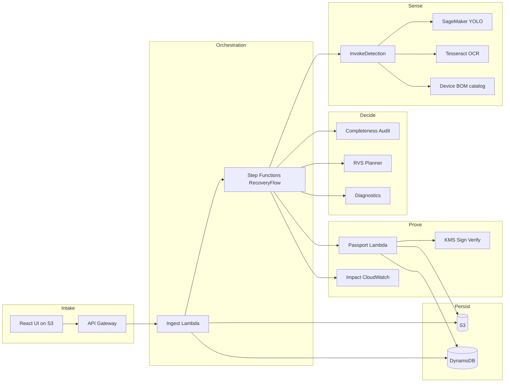
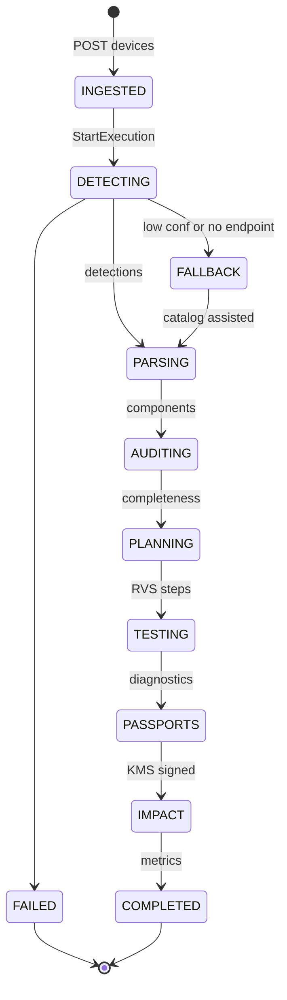
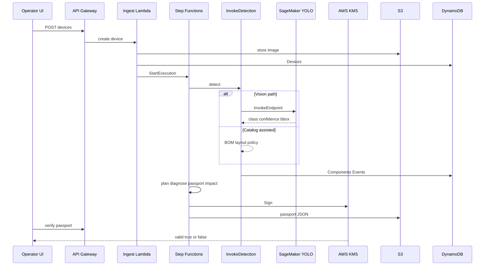

# AWS Builder Center article — RE:GENESIS

Use this file as the source of truth. Capture the screenshots in **Part A**, then paste **Part B + Part C** into [Builder Center → Create article](https://builder.aws.com). Upload images where you see `UPLOAD:` markers.

---

## Part A — Capture these screenshots first

Do this in order. Prefer the **live deployed site** + AWS console. Save as PNG, wide crop, no secrets in frame.

| # | Filename (suggested) | What to capture | Where | Why it belongs in the blog |
|---|----------------------|-----------------|-------|----------------------------|
| 1 | `01-landing-compare.png` | Landing: shredding card vs RE:GENESIS room | Live UI `/` | Problem → solution in one frame |
| 2 | `02-recovery-intake.png` | Recovery page with R740 (or photo) ready | `/recovery` | Who it’s for + usability |
| 3 | `03-device-bom-rvs.png` | Device results: BOM % + RVS timeline visible | `/devices/:id` | Core product mechanisms |
| 4 | `04-passport-verify.png` | Passports: **valid** verify result | `/passports` | KMS trust / prove |
| 5 | `05-passport-tamper.png` | After **Simulate Tamper** → failed | `/passports` | Judges love this contrast |
| 6 | `06-impact-ranges.png` | Impact: kg + CO₂e ranges | `/impact` | Environmental “after” |
| 7 | `07-architecture-ui.png` | Architecture page, one stage expanded | `/architecture` | Stack story in-product |
| 8 | `08-stepfunctions-success.png` | Step Functions execution = SUCCEEDED | AWS Console | “Built on AWS” proof |
| 9 | `09-sagemaker-endpoint.png` | Endpoint `regenesis-yolo-dev` (InService or OFF) | SageMaker console | Vision + cost discipline |
| 10 | `10-system-diagram.png` | Mermaid “System at a glance” exported PNG | [mermaid.live](https://mermaid.live) | Architecture hero |
| 11 | `11-workflow-diagram.png` | Mermaid workflow/state diagram PNG | mermaid.live | End-to-end stages |
| 12 | `12-sequence-diagram.png` | Mermaid sequence diagram PNG | mermaid.live | How pieces talk |

### Optional

| # | Filename | Capture |
|---|----------|---------|
| 13 | `13-cloudwatch-metrics.png` | CloudWatch custom metrics |
| 14 | `14-yolo-boxes.png` | Photo with detection boxes |

### Export Mermaid → PNG

1. Open https://mermaid.live  
2. Paste a Mermaid block from **Part D** below (or your README)  
3. **Actions → PNG**  
4. Save with filenames `10` / `11` / `12`

### Must-have if short on time

Upload at least: **1, 3, 4, 6, 8, 10**.

### Image tips

- Fill **alt text** on every upload in Builder Center  
- Crop personal email / account IDs  
- No access keys or `.env` values in frame  

---

## Part B — Article fields

### Title

```
RE:GENESIS: Closing the Loop on Enterprise E-Waste with Vision, Step Functions, and KMS Passports on AWS
```

### Summary

```
Environmental Hacks · Waste and Energy · e-waste. How Team RE:GENESIS shipped a Ship It recovery pipeline on AWS — detect components before shredding, audit BOM completeness, plan reuse-first disassembly, and mint verifiable Second-Life Passports — plus what fought back on SageMaker cost and hybrid vision.
```

### Tags (up to 5)

```
sagemaker
step-functions
lambda
sustainability
serverless
```

---

## Part C — Article body (paste into the editor)

Start pasting from the next heading. When you see `UPLOAD: filename.png`, insert that image and use the alt text on the next line.

---

# RE:GENESIS

### Adaptive electronics recovery — see it, plan it, prove it, reuse it.

**Computer vision → BOM completeness → RVS-ranked disassembly → diagnostics → KMS-signed Second-Life Passports**

Built for [Environmental Hacks | Bharat Builds Tour](https://www.wemakedevs.org/aws/env/) · Track: **Waste and Energy → E-waste**  
**Ship It** on AWS · Repo: [github.com/mitra9917/ReGenesis](https://github.com/mitra9917/ReGenesis)  
**Live demo:** [S3 website UI](http://regenesis-dev-uibucket-13iieilvqhoa.s3-website.ap-south-1.amazonaws.com)

> Team RE:GENESIS — Shubham Mitra & Tanmay

---

## Why this exists (Idea and Impact)

Global e-waste reached **~62 million tonnes** in 2022. Most still-valuable GPUs, RAM, SSDs, and NICs are shredded for bulk metal recovery — destroying reuse value and locking embodied carbon into landfill economics.

That is a **real environmental problem** under **Waste and Energy**: **what we throw away**, and whether cities and facilities can **close the loop** instead of burning value.

**RE:GENESIS** treats a retired server or laptop as a *recoverable product*, not scrap.

UPLOAD: `01-landing-compare.png`  
Alt: Side-by-side Industrial shredding versus RE:GENESIS recovery room on the product landing page.

| Industrial shredding | RE:GENESIS |
|----------------------|------------|
| Destroy first, sort metal later | Detect components *before* they are lost |
| No lineage for secondary buyers | **Second-Life Passport** (KMS-signed, verifiable) |
| Opaque ESG claims | Honest LCA ranges with cited factors |
| Manual guesswork on teardown order | **Reuse Value Score (RVS)** plans the sequence |

**Who it is for:** ITAD operators, circular-hardware recyclers, and reuse marketplaces — people who decide shred vs recover every day. **Design and usability** matter: someone who isn’t on our team should know what to do next.

---

## What it does in 60 seconds

1. **Upload** an interior photo (or pick Dell PowerEdge R740 / ThinkPad T14 / Cisco Catalyst 9300).  
2. **Vision** (SageMaker YOLOv8) or **catalog-assisted** fallback finds parts and scores **BOM completeness**.  
3. **Step Functions** runs detect → parse → plan → diagnose → passport → impact — live on the device page.  
4. **Verify** a passport: `valid: true` via **AWS KMS**. Tamper the JSON → verify fails.  
5. **Impact** shows kg diverted + CO₂e avoided as *ranges* (not fake precision).

UPLOAD: `02-recovery-intake.png`  
Alt: Recovery intake UI for starting an enterprise device recovery job.

---

## System at a glance

UPLOAD: `10-system-diagram.png`  
Alt: Architecture diagram showing UI, API Gateway, Step Functions, SageMaker, KMS, S3, and DynamoDB.

One job = one device photo + catalog model key. **Step Functions** owns the pipeline so every stage is visible, retryable, and auditable — that is **where AWS fits** as the spine, not a logo on a slide.

---

## End-to-end recovery workflow

UPLOAD: `11-workflow-diagram.png`  
Alt: State diagram of RecoveryFlow from ingest through passport and impact.

| Stage | What happens | Why it matters for the environment |
|-------|----------------|-------------------------------------|
| **Ingest** | Image → S3; device → DynamoDB; start RecoveryFlow | Durable evidence before any teardown |
| **Detect** | SageMaker YOLO *or* catalog-assisted; OCR can confirm model | Hybrid path so recovery doesn’t die when the endpoint is off |
| **Audit** | Detected counts vs catalog **BOM** | Catch under-detection *before* parts are lost to shred |
| **Plan** | Graph + **Reuse Value Score** | High embodied value / lower risk first |
| **Test** | Deterministic diagnostics | Repeatable demos; honest qualification |
| **Passport** | Canonical JSON → **KMS Sign** → S3 + DynamoDB | Tamper-evident **reuse** credential |
| **Impact** | Mass + CO₂e ranges; CloudWatch metrics | ESG-readable, scientifically honest |

UPLOAD: `03-device-bom-rvs.png`  
Alt: Device results showing BOM completeness score and RVS-ranked disassembly plan.

---

## How the pieces talk

UPLOAD: `12-sequence-diagram.png`  
Alt: Sequence diagram from operator UI through API Gateway, Step Functions, SageMaker, and KMS verify.

UPLOAD: `08-stepfunctions-success.png`  
Alt: AWS Step Functions console showing RecoveryFlow execution succeeded.

---

## Novel product mechanisms

### 1. Reuse Value Score (RVS)

Disassembly is not FIFO. Each step is scored from embodied CO₂e, recoverability, and risk so high-value parts (e.g. GPUs on an R740) surface early — with prerequisites respected.

### 2. BOM Completeness Audit

Vision alone lies. We compare detections to the device catalog **BOM** and surface gaps (`detected/expected`), severity, and remediation. Operators read a **percent**, not a research paper.

### 3. Hybrid detection (vision ↔ catalog)

| Path | When | Label |
|------|------|--------|
| SageMaker YOLO | Endpoint up, confidence acceptable | `vision` |
| Catalog-assisted | Low confidence, BOM mismatch, or endpoint off | `catalog-assisted` |
| Mock | Local / SAM tests | `mock` |

UPLOAD: `09-sagemaker-endpoint.png`  
Alt: Amazon SageMaker endpoint used for YOLO chassis-part detection.

### 4. Second-Life Passport (KMS)

Passports are signed with an asymmetric KMS key over canonical JSON.  
Verify proves integrity. Edit health scores → `valid: false`. That is the trust layer secondary **recycling** / reuse markets actually need.

UPLOAD: `04-passport-verify.png`  
Alt: One-click AWS KMS passport verification succeeding.

UPLOAD: `05-passport-tamper.png`  
Alt: Simulated tamper rejection showing signature verification failed.

---

## Built on AWS — Ship It stack

We deployed on AWS with **AWS SAM CLI** (open-source IaC) plus managed services:

| Service | Role | Why this service |
|---------|------|------------------|
| **AWS SAM / CloudFormation** | Whole stack as code | Repeatable facility deploy |
| **API Gateway** | REST for UI | One front door |
| **Lambda** | Ingest → impact, verify | Pay-per-recovery-job |
| **Step Functions** | RecoveryFlow | Visual proof; retries; auditable stages |
| **S3** | Images, logs, passports, static UI | Durable artifacts + demo URL |
| **DynamoDB** | Devices, Components, Passports, Events | Low-latency UI polling |
| **SageMaker** | Custom YOLO endpoint | Domain vision for chassis interiors |
| **KMS** | Sign / Verify | Cryptographic reuse trust |
| **CloudWatch** | Logs + custom metrics | Ops + demo KPIs |
| **SNS** | Job-complete hook | Operator notifications |

UPLOAD: `07-architecture-ui.png`  
Alt: In-app architecture explorer walking through AWS stages for judges.

---

## Computer vision (brief)

| Item | Choice |
|------|--------|
| Detector | YOLOv8n (Ultralytics) |
| Serve | SageMaker realtime endpoint |
| Schema | Stable 9-class map (CPU, GPU, RAM, SSD, HDD, NIC, …) |
| Fallback | Catalog-assisted when endpoint off or confidence weak |

**Cost guard:** endpoints bill while **InService**. We delete the endpoint when idle and recreate for demos — the same lesson many student Ship It teams learn the hard way.

---

## Impact after the fix

UPLOAD: `06-impact-ranges.png`  
Alt: Impact ledger showing mass diverted and CO₂e avoided as honest ranges.

Before RE:GENESIS: shred-first, zero reuse credentials.  
After: recoverable components, cryptographic lineage, and measurable diversion — so operators can **reuse** more and **throw away** less.

---

## What fought back (Learning and growth)

1. **SageMaker billing and wait** — An always-on endpoint burns credits. We added explicit on/off/status scripts and refuse to make the environmental workflow depend on a perfect live endpoint.  
2. **Vision fails in the wild** — So we shipped **catalog-assisted** fallback: the pipeline still plans, tests, and signs.  
3. **Trust is a product feature** — A PDF certificate is not enough. **KMS** verify plus tamper fail made Second-Life Passports real.

---

## Try it

- **GitHub:** https://github.com/mitra9917/ReGenesis  
- **Deployed UI:** http://regenesis-dev-uibucket-13iieilvqhoa.s3-website.ap-south-1.amazonaws.com  
- **Demo video:** *(paste your YouTube link)*  

**RE:GENESIS** — recover the component, not just the metal.

— Shubham Mitra & Tanmay · Team RE:GENESIS · Environmental Hacks · Waste and Energy

---

## Part D — Mermaid blocks to export as PNGs

### 10 — System diagram



### 11 — Workflow



### 12 — Sequence



---

## Part E — Publish checklist

1. [ ] Screenshots 1–12 (or must-haves) saved  
2. [ ] Mermaid PNGs exported from mermaid.live  
3. [ ] https://builder.aws.com → **+** → **Create article**  
4. [ ] Title + Summary + Tags from Part B  
5. [ ] Body from Part C with images inserted  
6. [ ] Preview → Publish → wait for moderation  
7. [ ] Copy article URL into Environmental Hacks **Blog links**  
