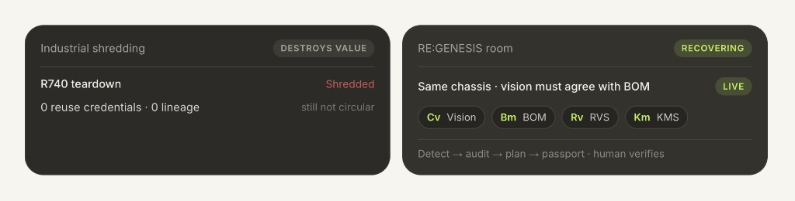
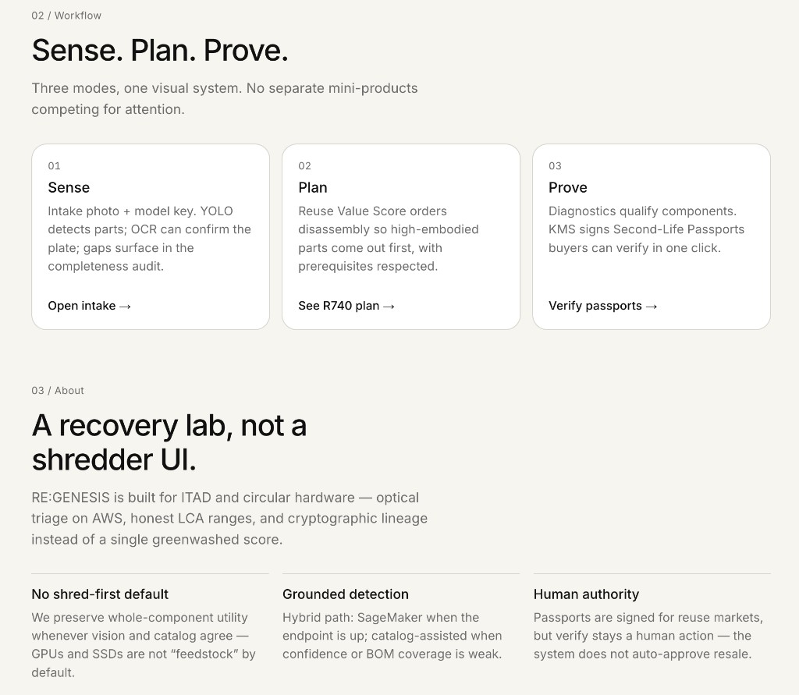
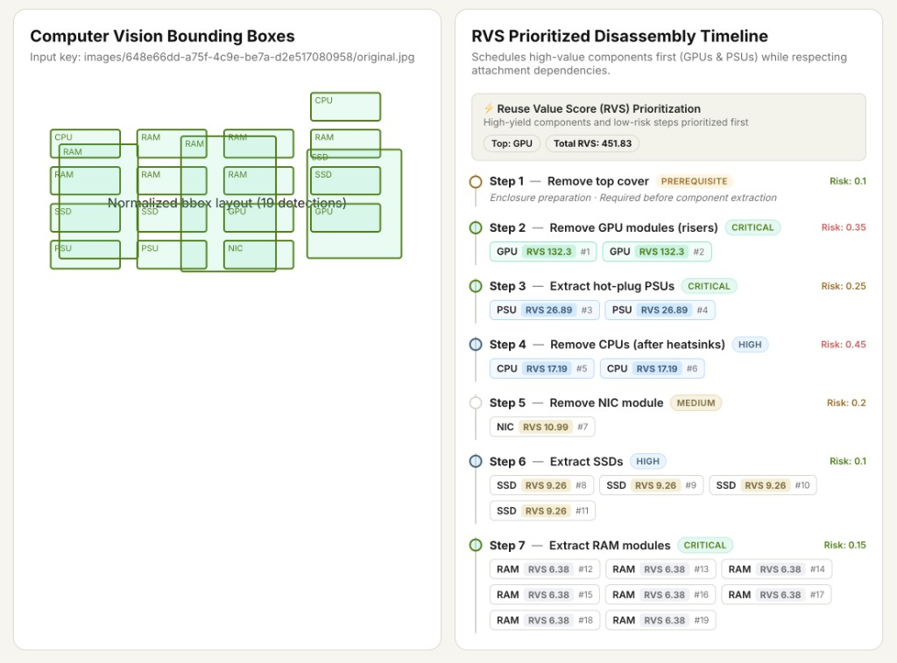
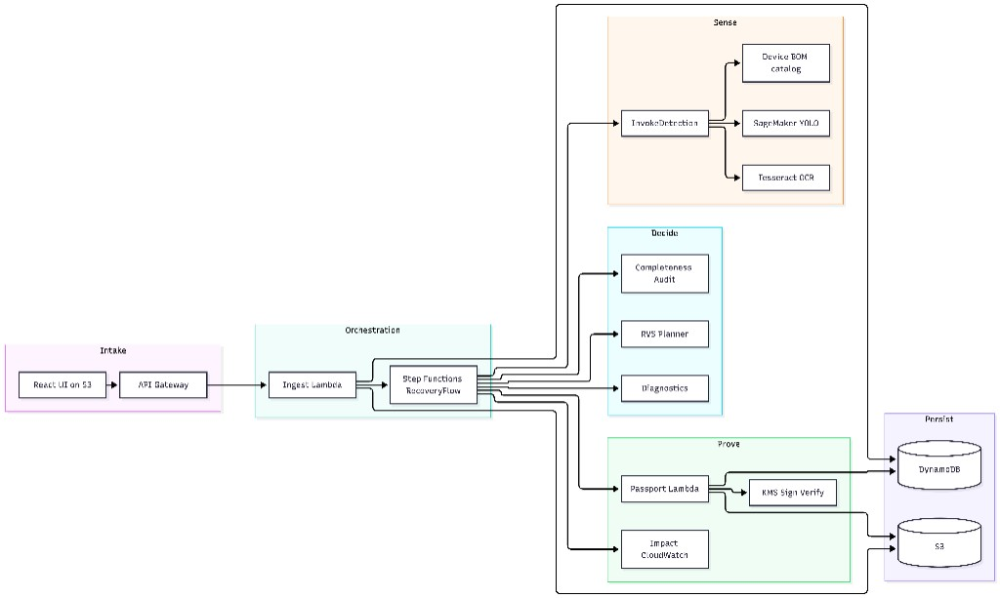
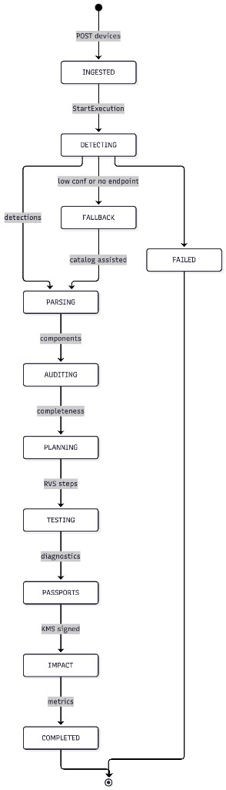
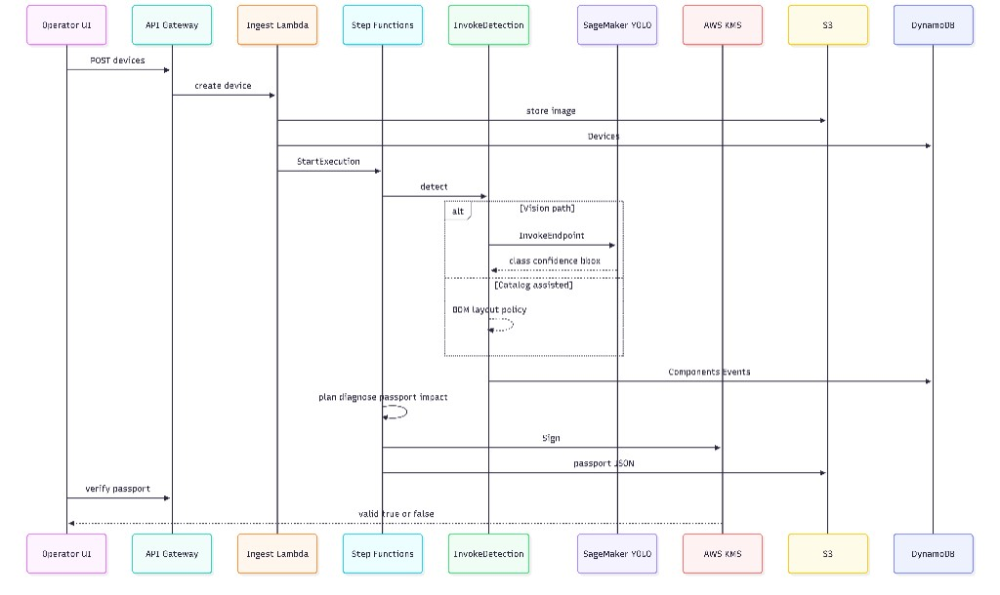
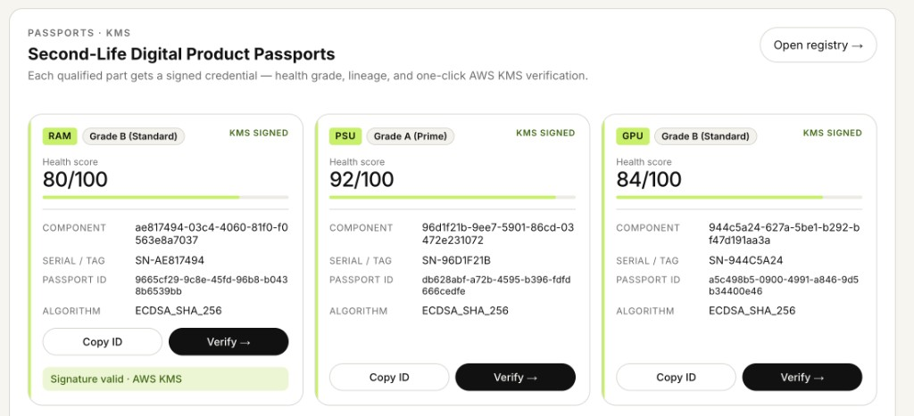
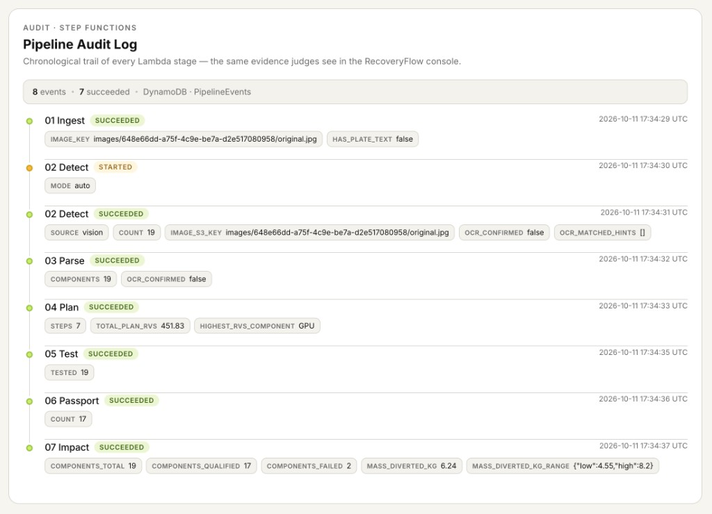

# RE:GENESIS: Closing the Loop on Enterprise E-Waste with Vision, Step Functions, and KMS Passports on AWS

> **Paste guide for AWS Builder Center**  
> 1. Title = the H1 below (without `#`)  
> 2. Summary = the block under **Summary for the editor**  
> 3. Body = everything from **Adaptive electronics recovery** downward  
> 4. Upload each image from `docs/builder-blog/assets/` when you hit an image in the body  
> 5. Tags: `sagemaker` · `step-functions` · `lambda` · `sustainability` · `serverless`

---

## Summary for the editor

```
Environmental Hacks · Waste and Energy · e-waste. How Team RE:GENESIS shipped a Ship It recovery pipeline on AWS — detect components before shredding, audit BOM completeness, plan reuse-first disassembly, and mint verifiable Second-Life Passports — plus what fought back on SageMaker cost and hybrid vision.
```

---

# Body starts here (copy from this line)

---

### Adaptive electronics recovery — see it, plan it, prove it, reuse it.

**Computer vision → BOM completeness → RVS-ranked disassembly → diagnostics → KMS-signed Second-Life Passports**

Built for [Environmental Hacks | Bharat Builds Tour](https://www.wemakedevs.org/aws/env/) · Track: **Waste and Energy → E-waste**

| | |
|---|---|
| **Ship It** | Deployed on AWS |
| **GitHub** | [github.com/mitra9917/ReGenesis](https://github.com/mitra9917/ReGenesis) |
| **Live demo** | [S3 website UI](http://regenesis-dev-uibucket-13iieilvqhoa.s3-website.ap-south-1.amazonaws.com) |
| **Team** | RE:GENESIS — Shubham Mitra & Tanmay |

---

## 1. Why this exists — Idea and Impact

Global e-waste reached **~62 million tonnes** in 2022. Most still-valuable GPUs, RAM, SSDs, and NICs are shredded for bulk metal recovery — destroying reuse value and locking embodied carbon into landfill economics.

That is a **real environmental problem** under **Waste and Energy**: **what we throw away**, and whether cities and facilities can **close the loop** instead of burning value.

**RE:GENESIS** treats a retired server or laptop as a *recoverable product*, not scrap.



| Industrial shredding | RE:GENESIS |
|---|---|
| Destroy first, sort metal later | Detect components *before* they are lost |
| No lineage for secondary buyers | **Second-Life Passport** (KMS-signed, verifiable) |
| Opaque ESG claims | Honest LCA ranges with cited factors |
| Manual guesswork on teardown order | **Reuse Value Score (RVS)** plans the sequence |

**Who it is for:** ITAD operators, circular-hardware recyclers, and reuse marketplaces — the people who decide shred vs recover every day.

**Design and usability:** someone who is not on our team should open the UI and know the next click — intake → audit → plan → verify.

---

## 2. What it does — Sense · Plan · Prove

One visual system. Three modes. No mini-products competing for attention.



| Mode | What the operator sees | Outcome |
|---|---|---|
| **Sense** | Intake photo + model key; YOLO + OCR; completeness gaps | Parts found *before* teardown |
| **Plan** | Reuse Value Score orders disassembly | High-embodied parts first |
| **Prove** | Diagnostics + KMS Second-Life Passports | Buyers verify in one click |

**What it does in 60 seconds**

1. Upload an interior photo — or pick Dell PowerEdge R740 / ThinkPad T14 / Cisco Catalyst 9300  
2. Vision (**SageMaker** YOLOv8) or **catalog-assisted** fallback finds parts and scores **BOM completeness**  
3. **Step Functions** runs detect → parse → plan → diagnose → passport → impact  
4. Verify a passport: `valid: true` via **AWS KMS** — tamper the JSON → verify fails  
5. Impact shows kg diverted + CO₂e avoided as *ranges* (not fake precision)

---

## 3. Working product — vision boxes and RVS plan

On a live recovery run, the operator does not get a black-box score. They get evidence.



### What this screen proves

| Signal | In the demo | Why judges should care |
|---|---|---|
| **Detections** | 19 components (CPU, RAM, SSD, GPU, PSU, NIC) | Vision sees the chassis before shred |
| **BOM completeness** | Detected vs expected catalog slots | Catches under-detection early |
| **RVS total** | **451.83** — GPU first after cover | Reuse value drives teardown order |
| **Prerequisites** | Step 1 = remove top cover | Safe, operator-realistic sequencing |

**Reuse Value Score (RVS)** is not FIFO. High-yield components (GPUs, PSUs) surface early; attachment dependencies still win.

**BOM** means Bill of Materials — the expected parts list for that model. Vision finds what *is* visible; BOM is the checklist we audit against.

---

## 4. Architecture — Built on AWS · Ship It

**UPLOAD ORDER:** use `06-system-architecture.jpg` here.



| Layer | AWS building blocks | Job in RE:GENESIS |
|---|---|---|
| **Intake** | S3 static UI · API Gateway | Operator front door |
| **Orchestration** | Lambda · **Step Functions** RecoveryFlow | Auditable spine |
| **Sense** | **SageMaker** YOLO · Tesseract OCR · BOM catalog | See the parts |
| **Decide** | Completeness audit · RVS planner · diagnostics | Decide what to free first |
| **Prove** | Passport Lambda · **KMS** · CloudWatch impact | Sign trust + measure diversion |
| **Persist** | **S3** · **DynamoDB** | Images, passports, events |

**AWS open source:** **AWS SAM CLI** deploys this stack as infrastructure as code.  
**Where AWS fits:** not a badge — it *is* the recovery spine.

### RecoveryFlow state machine



Hybrid detection is deliberate:

| Path | When | Label |
|---|---|---|
| SageMaker YOLO | Endpoint up, confidence acceptable | `vision` |
| Catalog-assisted | Low confidence, BOM mismatch, or endpoint **OFF** | `catalog-assisted` |
| Mock | Local / SAM tests | `mock` |

### How the pieces talk



---

## 5. Prove — Second-Life Passports on KMS

Each qualified part gets a signed credential — health grade, lineage, and one-click **AWS KMS** verification.



| Field on the card | Meaning |
|---|---|
| **KMS SIGNED** | Asymmetric signature over canonical JSON |
| **Health score** | Diagnostic qualification (e.g. 80 / 92 / 84) |
| **Algorithm** | `ECDSA_SHA_256` |
| **Verify →** | Human action — the system does not auto-approve resale |

Edit the payload after signing → verification returns **invalid**. That is the trust layer secondary **recycling** markets need — not a PDF anyone can edit.

---

## 6. Execution proof — Pipeline Audit Log

The same trail judges see in the Step Functions console, mirrored in the product UI from **DynamoDB PipelineEvents**.



### What this run earned (live numbers)

| Stage | Result | Notable detail |
|---|---|---|
| Ingest | Succeeded | Image landed in S3 |
| Detect | Succeeded | `SOURCE: vision` · **19** detections |
| Plan | Succeeded | **7** steps · **RVS 451.83** · top = **GPU** |
| Test | Succeeded | 19 components tested |
| Passport | Succeeded | **17** Second-Life Passports minted |
| Impact | Succeeded | **6.24 kg** diverted · range **4.55–8.2 kg** |

That is **execution**: a working end-to-end recovery on AWS — not a mock slide.

---

## 7. AWS services — named and purposeful

| Service | Role | Why this service |
|---|---|---|
| **AWS SAM / CloudFormation** | Whole stack as code | Repeatable facility deploy |
| **Amazon API Gateway** | REST for the UI | One secure front door |
| **AWS Lambda** | Ingest → impact, verify | Pay-per-recovery-job |
| **AWS Step Functions** | RecoveryFlow orchestration | Visual proof; retries; auditable stages |
| **Amazon S3** | Images, logs, passports, static UI | Durable artifacts + demo URL |
| **Amazon DynamoDB** | Devices, Components, Passports, Events | Low-latency UI polling |
| **Amazon SageMaker** | Custom YOLO endpoint | Domain vision for chassis interiors |
| **AWS KMS** | Sign / Verify passports | Cryptographic reuse trust |
| **Amazon CloudWatch** | Logs + impact metrics | Ops + demo KPIs |
| **Amazon SNS** | Job-complete hook | Operator notifications |

---

## 8. What fought back — Learning and growth

1. **SageMaker billing and wait** — An always-on endpoint burns credits. We added explicit on/off/status scripts and refuse to make the environmental workflow depend on a perfect live endpoint.  
2. **Vision fails in the wild** — So we shipped **catalog-assisted** fallback: the pipeline still plans, tests, and signs.  
3. **Trust is a product feature** — A PDF “certificate” is not enough. **KMS** verify plus tamper fail made Second-Life Passports real.

---

## 9. Try it

| Resource | Link |
|---|---|
| **GitHub** | https://github.com/mitra9917/ReGenesis |
| **Deployed UI** | http://regenesis-dev-uibucket-13iieilvqhoa.s3-website.ap-south-1.amazonaws.com |
| **Demo video** | *(paste your YouTube URL)* |
| **Hackathon** | [Environmental Hacks](https://www.wemakedevs.org/aws/env/) · Waste and Energy · e-waste |

---

### Closing

Before RE:GENESIS: shred-first, zero reuse credentials.  
After: recoverable components, cryptographic lineage, and measurable diversion — so operators can **reuse** more and **throw away** less.

**RE:GENESIS** — recover the component, not just the metal.

— **Shubham Mitra & Tanmay** · Team RE:GENESIS · Environmental Hacks · Bharat Builds Tour

---

## Image upload cheat sheet (Builder Center)

Upload these files from `docs/builder-blog/assets/` in this order as you scroll the body:

| Order | File | Section |
|---|---|---|
| 1 | `01-landing-compare.png` | Why this exists |
| 2 | `02-sense-plan-prove.png` | Sense · Plan · Prove |
| 3 | `03-vision-and-rvs.png` | Working product |
| 4 | `06-system-architecture.jpg` | Architecture |
| 5 | `07-recovery-workflow.png` | RecoveryFlow |
| 6 | `08-sequence-diagram.jpg` | How pieces talk |
| 7 | `04-passports-kms.png` | Passports |
| 8 | `05-pipeline-audit-log.png` | Audit log |

Alt text: copy the text inside each `` when the uploader asks for it.
